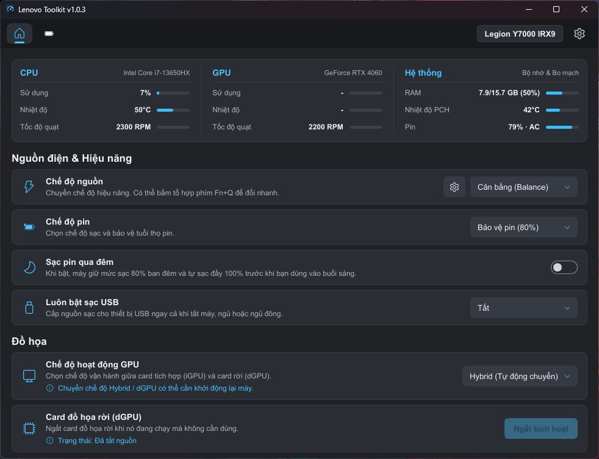
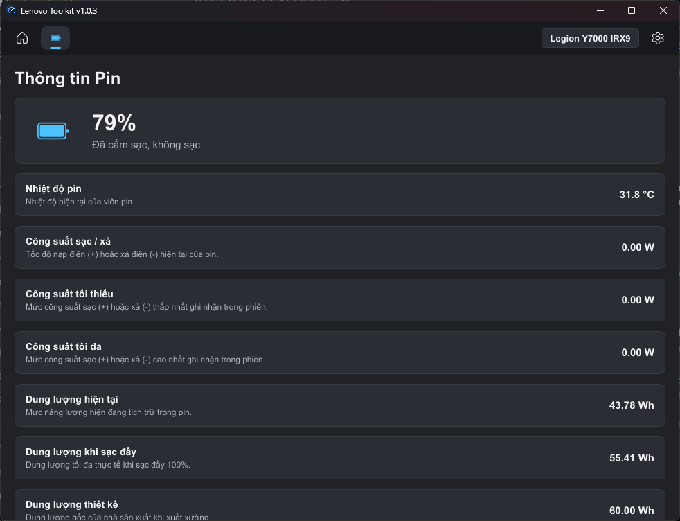
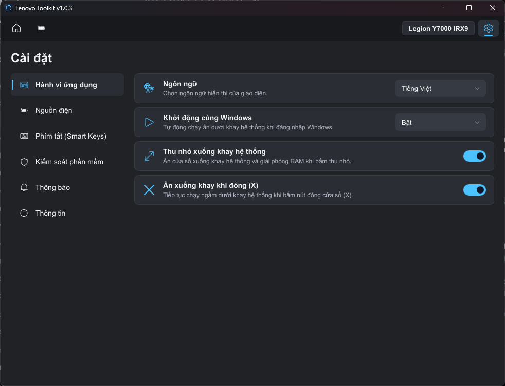
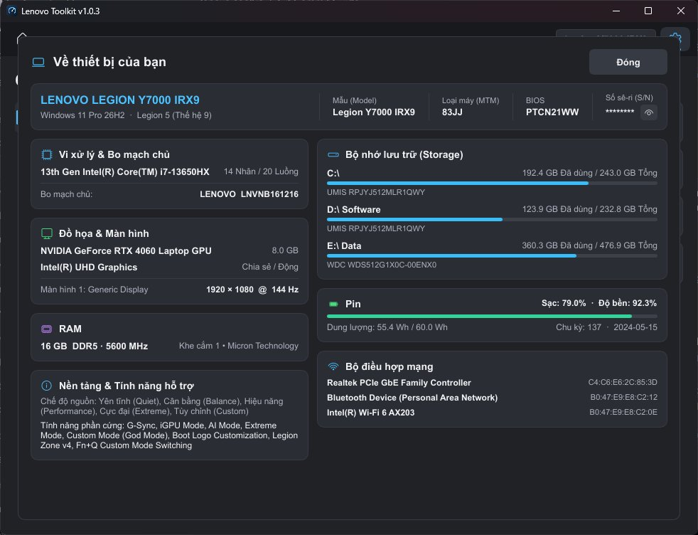

<p align="center">
  
</p>

<h1 align="center">Lenovo Toolkit</h1>

<p align="center"><b>Ứng dụng nhỏ cho laptop Lenovo (Legion, LOQ, IdeaPad, Yoga, ThinkBook, ThinkPad) trên Windows.</b></p>

<p align="center">
  Chế độ nguồn, quạt và cảm biến, pin, đèn và phím Fn trong một cửa sổ nhẹ nằm ở khay hệ thống.<br>
  Bản port Rust của LenovoLegionToolkit, giao diện Slint, bộ cài khoảng 6,3 MB, không cần .NET.
</p>

<p align="center"><b>Tiếng Việt</b> · <a href="README.en.md">English</a> · <a href="https://github.com/erikpuw/lenovo-toolkit/releases/latest"></a></p>

> Đây là dự án không chính thức, không liên kết với Lenovo. Ứng dụng ghi xuống firmware qua driver Lenovo và WMI, nên hãy tự chịu rủi ro khi dùng. Chỉ tải bản dựng ở mục [Releases](https://github.com/erikpuw/lenovo-toolkit/releases) của repository này. Ứng dụng chưa ký số, nên lần đầu Windows có thể hiện cảnh báo SmartScreen.

## Tính năng

| Tính năng | Chức năng |
|---|---|
| Chế độ nguồn | Quiet, Balance, Performance, Extreme và Custom, tùy máy hỗ trợ. Fn+Q dùng được và ứng dụng cập nhật theo. Performance, Extreme và Custom cần cắm sạc, và trên các BIOS có lỗi chuyển chế độ thì ứng dụng đi qua một chế độ trung gian trước, giống bản gốc. Ở Balance, nút bánh răng mở công tắc AI Engine. |
| Custom mode | Hai cấu hình. Mặc định của Lenovo bị khóa. Cấu hình Custom chỉnh giới hạn firmware theo đúng bước của firmware và cảnh báo khi giá trị rủi ro. Quạt tối đa mặc định tắt và được ghi lại là tắt mỗi lần áp dụng, nên quạt không bị kẹt ở 100%. |
| Quạt và cảm biến | Nhiệt độ CPU, GPU và PCH, tốc độ quạt, mức dùng CPU, GPU và RAM, phần trăm pin. |
| Pin | Chế độ sạc (Thường, Nhanh, Bảo vệ pin 80%), sạc pin qua đêm, luôn bật sạc USB. Trang Pin hiện nhiệt độ, tốc độ sạc và xả, dung lượng, sức khỏe, số chu kỳ và ngày tháng. |
| Đồ họa và màn hình | Chế độ hoạt động GPU, trạng thái card rời, công tắc ép xung GPU nếu máy hỗ trợ, tần số quét, overdrive. Fn+R đổi vòng tần số quét. |
| Phím và đèn | Đèn nền bàn phím, đèn logo và đèn cổng, khóa touchpad, khóa Fn, khóa phím Windows. Fn+F4 tắt mic và Fn+F9 mở ứng dụng. |
| Thông báo phím | Một dòng ngắn ở đáy màn hình khi đổi chế độ nguồn, Fn lock, camera, mic, touchpad và đèn bàn phím, mỗi loại có icon riêng. Từng loại tắt được trong Cài đặt. Không hiện đè lên game toàn màn hình hay lúc trình chiếu. |
| Phần mềm Lenovo | Có thể vô hiệu hóa Vantage, Legion Zone, Legion Space và dịch vụ phím nóng Lenovo. Ứng dụng áp dụng lại lựa chọn này mỗi lần khởi động. |
| Khay hệ thống | Rê chuột hiện chế độ nguồn, CPU, GPU, RAM, quạt và pin. Menu chuột phải đổi chế độ nguồn. Cửa sổ ẩn xuống khay thì ngừng đọc cảm biến và trả lại bộ nhớ. |
| Tự chạy cùng Windows | Một tác vụ theo lịch lúc đăng nhập mở ứng dụng ẩn dưới khay. |
| Ngôn ngữ | Tiếng Việt và tiếng Anh. |

## Máy được hỗ trợ

| Nhóm | Dòng máy | Trạng thái |
|---|---|---|
| Gaming | Legion, LOQ, IdeaPad Gaming | Đầy đủ các tính năng qua WMI chính hãng và `EnergyDrv`. |
| Không gaming (ITS) | ThinkBook, IdeaPad, Slim, Yoga, XiaoXin, Motobook, Lenovo V | Đổi chế độ nhiệt/quạt ITS (`Auto`, `Cool`, `Performance`, `Geek` nếu firmware hỗ trợ) qua `EnergyDrv` chính hãng, chế độ sạc pin, sạc qua đêm, USB, đèn phím, khóa Fn và tần số quét màn hình. Nếu firmware không mở DYTC thì tự chuyển sang Windows Power Mode. |
| ThinkPad | ThinkPad (T, X, P, L, E, Z, X1) | Đổi Windows Power Mode đồng bộ vào `IBMPmDrv` / tản nhiệt Lenovo, bật/tắt ngưỡng sạc pin qua `IBMPmDrv`, tần số quét màn hình và thông tin pin/hệ thống. Chỉ đi qua driver chính hãng Lenovo, không ghi thẳng thanh ghi EC. |

Nhóm máy được xác định theo tên model. Các lệnh chỉ dùng cho máy Gaming sẽ tự ẩn trên máy không gaming và ThinkPad.

## Ảnh chụp

| Ảnh chụp | Ảnh chụp |
|---|---|
| <br>**Trang chính**: CPU, GPU, hệ thống, chế độ nguồn, pin và đồ họa | <br>**Thông tin pin**: nhiệt độ, công suất sạc, dung lượng, sức khỏe |
| <br>**Cài đặt**: ngôn ngữ, khởi động cùng Windows, thu nhỏ xuống khay | <br>**Về thiết bị**: model, BIOS, bo mạch, bộ nhớ, pin, card mạng |

## Cài đặt

1. Nếu Lenovo Toolkit đang chạy, hãy tắt hẳn ứng dụng (kể cả biểu tượng dưới khay hệ thống) trước khi cài đặt hoặc cập nhật.
2. Tải `lenovo-toolkit-setup-v<ver>-x64.exe` (khoảng 6,3 MB) ở mục [Releases](https://github.com/erikpuw/lenovo-toolkit/releases) rồi chạy để cài đặt. Bộ cài gồm sẵn bản giao diện và `lenovo-toolkit-cli.exe`, tạo lối tắt Start Menu, Desktop, lịch tự khởi động ẩn cùng Windows và mục gỡ cài đặt trong Settings -> Apps.
3. Ứng dụng xin quyền quản trị vì phải nói chuyện với driver.

## Build từ mã nguồn

Cần Windows x64, Rust stable mới (edition 2024) và Windows SDK, nơi có `rc.exe`.

```
cargo test --workspace
cargo build --release

# Tạo bản cài đặt đánh số phiên bản vào thư mục dist/
powershell -ExecutionPolicy Bypass -File tools/build-dist.ps1
# -> dist/lenovo-toolkit-setup-v<ver>-x64.exe
```

Ứng dụng nhúng manifest quyền quản trị, nên chạy `cargo run --release -p lenovo-toolkit` từ terminal đã nâng quyền.

## Dòng lệnh

`lenovo-toolkit-cli` bao phủ phần lớn ứng dụng. Lệnh đọc từ driver pin hoặc registry chạy được với tài khoản thường. Lệnh dùng WMI hoặc ghi xuống phần cứng cần quyền quản trị.

```
lenovo-toolkit-cli battery get
lenovo-toolkit-cli battery set <normal|rapid|conservation>
lenovo-toolkit-cli power get
lenovo-toolkit-cli power set <quiet|balance|performance|extreme|godmode>
lenovo-toolkit-cli its <get|supported|set <auto|cool|performance|geek>>
lenovo-toolkit-cli winpower <get|set <efficiency|balanced|performance>>
lenovo-toolkit-cli gamezone <winkey|gsync|overdrive|touchpad|igpu> <get|supported|set <n>>
lenovo-toolkit-cli <fnlock|nightcharge|onelevel> <get|set <on|off>>
lenovo-toolkit-cli fan <sensors|max|fullspeed <get|set <on|off>>>
lenovo-toolkit-cli light <ports|logo|kbd> <get|supported|set <n>>
lenovo-toolkit-cli usb <get|set <off|sleeping|always>>
lenovo-toolkit-cli kbd <get|max|set <level>>
lenovo-toolkit-cli threshold <get|off|set <start> <stop>>
lenovo-toolkit-cli info
lenovo-toolkit-cli ai <status|refresh|set <on|off>>
lenovo-toolkit-cli custom show
lenovo-toolkit-cli games
lenovo-toolkit-cli software status
lenovo-toolkit-cli software <fnkeys|vantage|legionzone|legionspace> <disable|enable>
lenovo-toolkit-cli keys
lenovo-toolkit-cli events
```

`threshold` cần key registry `HKLM\SOFTWARE\WOW6432Node\Lenovo\PWRMGRV` do phần mềm Lenovo tạo. Máy không có key này sẽ báo không hỗ trợ.

## Không có trong bản này

Macro, automation, tải xuống, Spectrum RGB, OSD, kiểm tra cập nhật và tích hợp được bỏ có chủ đích. Còn thiếu:

- Máy ITS (xem trên).
- Thông báo cho bộ sạc AC, Caps Lock và Num Lock.
- Phím Fn+F8 chế độ máy bay và đèn LED trên phím Fn+F4.
- Dời hoặc đổi cỡ thông báo.

## Cấu trúc dự án

| Crate | Nội dung |
|---|---|
| `lenovo-toolkit` | Ứng dụng: giao diện Slint, khay Win32, thông báo phím. |
| `lenovo-toolkit-core` | Driver (`EnergyDrv`, `IBMPmDrv`), WMI, pin, quạt, đèn, phím, cài đặt. |
| `lenovo-toolkit-cli` | Dòng lệnh. |

## Ghi công và giấy phép

Dự án phát hành theo GNU General Public License v3.0, xem [LICENSE](LICENSE).

Ý tưởng và cách nói chuyện với phần cứng Lenovo đến từ [LenovoLegionToolkit](https://github.com/BartoszCichecki/LenovoLegionToolkit) của Bartosz Cichecki, người tạo ra dự án, và từ bản do nhóm [LenovoLegionToolkit-Team](https://github.com/LenovoLegionToolkit-Team/LenovoLegionToolkit) tiếp tục phát triển. Cả hai theo GPL-3.0. Bản này do erikpuw viết lại từ đầu bằng Rust và lược bỏ phần lớn tính năng của họ, xin cảm ơn các tác giả.
